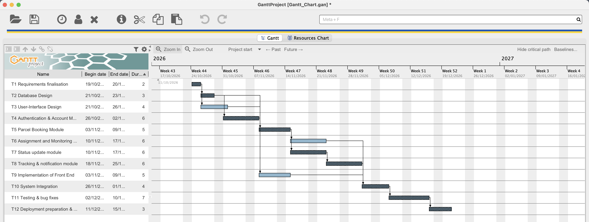

# Exercise 7: Critical Path

## Critical Path

T1 → T2 → T4 → T5 → T7 → T8 → T10 → T11 → T12

## Activities on the Critical Path

| ID | Task Name | Duration (Days) |
| --- | --- | --- |
| T1 | Requirements finalisation | 2 |
| T2 | Database Design | 3 |
| T4 | Authentication & Account Management | 6 |
| T5 | Parcel Booking Module | 5 |
| T7 | Status update module | 6 |
| T8 | Tracking & notification module | 6 |
| T10 | System Integration | 4 |
| T11 | Testing & bug fixes | 7 |
| T12 | Deployment preparation & documentation | 3 |

## Expected Project Duration

42 days

## Calculations

The values use the same method as the lecture notes, where the first task starts on day 1.

- Forward pass: ES = max(EF of predecessors) + 1, EF = ES + E - 1
- Backward pass: LF = min(LS of successors) - 1, LS = LF - E + 1
- Slack = LS - ES = LF - EF

### Forward Pass

| ID | Predecessor(s) | E | ES | EF |
| --- | --- | --- | --- | --- |
| T1 | None | 2 | 1 | 1 + 2 - 1 = 2 |
| T2 | T1 | 3 | 2 + 1 = 3 | 3 + 3 - 1 = 5 |
| T3 | T1 | 4 | 2 + 1 = 3 | 3 + 4 - 1 = 6 |
| T4 | T2 | 6 | 5 + 1 = 6 | 6 + 6 - 1 = 11 |
| T5 | T2, T4 | 5 | max(5, 11) + 1 = 12 | 12 + 5 - 1 = 16 |
| T6 | T5 | 6 | 16 + 1 = 17 | 17 + 6 - 1 = 22 |
| T7 | T5 | 6 | 16 + 1 = 17 | 17 + 6 - 1 = 22 |
| T8 | T7 | 6 | 22 + 1 = 23 | 23 + 6 - 1 = 28 |
| T9 | T3, T4 | 5 | max(6, 11) + 1 = 12 | 12 + 5 - 1 = 16 |
| T10 | T6, T8, T9 | 4 | max(22, 28, 16) + 1 = 29 | 29 + 4 - 1 = 32 |
| T11 | T10 | 7 | 32 + 1 = 33 | 33 + 7 - 1 = 39 |
| T12 | T11 | 3 | 39 + 1 = 40 | 40 + 3 - 1 = 42 |

### Backward Pass

| ID | Successor(s) | E | LF | LS |
| --- | --- | --- | --- | --- |
| T12 | None | 3 | 42 (= EF) | 42 - 3 + 1 = 40 |
| T11 | T12 | 7 | 40 - 1 = 39 | 39 - 7 + 1 = 33 |
| T10 | T11 | 4 | 33 - 1 = 32 | 32 - 4 + 1 = 29 |
| T9 | T10 | 5 | 29 - 1 = 28 | 28 - 5 + 1 = 24 |
| T8 | T10 | 6 | 29 - 1 = 28 | 28 - 6 + 1 = 23 |
| T7 | T8 | 6 | 23 - 1 = 22 | 22 - 6 + 1 = 17 |
| T6 | T10 | 6 | 29 - 1 = 28 | 28 - 6 + 1 = 23 |
| T5 | T6, T7 | 5 | min(23, 17) - 1 = 16 | 16 - 5 + 1 = 12 |
| T4 | T5, T9 | 6 | min(12, 24) - 1 = 11 | 11 - 6 + 1 = 6 |
| T3 | T9 | 4 | 24 - 1 = 23 | 23 - 4 + 1 = 20 |
| T2 | T4, T5 | 3 | min(6, 12) - 1 = 5 | 5 - 3 + 1 = 3 |
| T1 | T2, T3 | 2 | min(3, 20) - 1 = 2 | 2 - 2 + 1 = 1 |

### Slack

| ID | ES | EF | LS | LF | Slack | Critical? |
| --- | --- | --- | --- | --- | --- | --- |
| T1 | 1 | 2 | 1 | 2 | 0 | Yes |
| T2 | 3 | 5 | 3 | 5 | 0 | Yes |
| T3 | 3 | 6 | 20 | 23 | 17 | No |
| T4 | 6 | 11 | 6 | 11 | 0 | Yes |
| T5 | 12 | 16 | 12 | 16 | 0 | Yes |
| T6 | 17 | 22 | 23 | 28 | 6 | No |
| T7 | 17 | 22 | 17 | 22 | 0 | Yes |
| T8 | 23 | 28 | 23 | 28 | 0 | Yes |
| T9 | 12 | 16 | 24 | 28 | 12 | No |
| T10 | 29 | 32 | 29 | 32 | 0 | Yes |
| T11 | 33 | 39 | 33 | 39 | 0 | Yes |
| T12 | 40 | 42 | 40 | 42 | 0 | Yes |

## Explanation

After the forward and backward pass, the tasks with slack = 0 are T1, T2, T4, T5, T7, T8, T10, T11 and T12. These tasks have no room to move, so a delay in any of them pushes the whole project past 42 days. They also connect into one chain from the first task to the last, which makes it the critical path.

Checking every path through the network gives the same answer, since the critical path is the longest one:

| Path | Duration (Days) |
| --- | --- |
| T1 → T2 → T4 → T5 → T7 → T8 → T10 → T11 → T12 | 42 |
| T1 → T2 → T4 → T5 → T6 → T10 → T11 → T12 | 36 |
| T1 → T2 → T5 → T7 → T8 → T10 → T11 → T12 | 36 |
| T1 → T2 → T4 → T9 → T10 → T11 → T12 | 30 |
| T1 → T2 → T5 → T6 → T10 → T11 → T12 | 30 |
| T1 → T3 → T9 → T10 → T11 → T12 | 25 |

T4 is on the critical path even though T2 also links straight to T5, because T5 needs both T2 and T4 to finish and T4 finishes later (day 11 vs day 5). The non-critical tasks are T3 (17 days slack), T9 (12 days slack) and T6 (6 days slack).

## Tool Verification

The schedule was entered in GanttProject 3.3 (`Gantt_Chart/Gantt_Chart.gan`) with the same tasks, durations and dependencies as the WBS, starting Monday 19 October 2026. With Show critical path turned on, GanttProject marks T1, T2, T4, T5, T7, T8, T10, T11 and T12 as critical and leaves T3, T6 and T9 as normal tasks. The project ends on the 42nd working day (15 December 2026), which matches the manual calculation.

